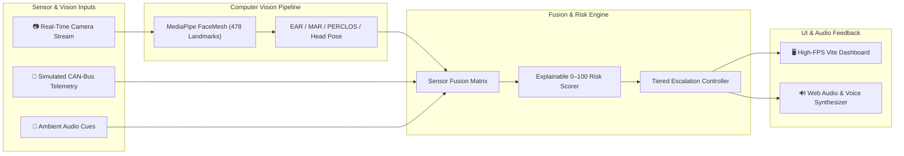

<div align="center">

# 🚗 NeuroDrive AI (Driver Security System)

### Real-Time Computer Vision & Sensor-Fusion Driver Safety System

*Monitoring driver vigilance, eye behavior, 3D head pose, and distraction telemetry with explainable risk scoring.*

[](https://github.com/Scempyyy/driver-security-system)
[](https://www.typescriptlang.org)
[](https://opencv.org)
[](https://developers.google.com/mediapipe)
[](https://vitejs.dev)
[](https://python.org)

[Explore Codebase](https://github.com/Scempyyy/driver-security-system) · [Report Bug](https://github.com/Scempyyy/driver-security-system/issues) · [Request Feature](https://github.com/Scempyyy/driver-security-system/issues)

</div>

---

## 📖 Overview

**NeuroDrive AI** is a real-time computer-vision safety system engineered to combat driver fatigue, microsleeps, and inattentiveness. Combining facial landmark detection (478 3D points) with vehicle telemetry and acoustic cues, NeuroDrive calculates explainable physiological risk metrics and triggers tiered audio-visual alerts before accidents occur.

> ⚠️ **Disclaimer:** This is an experimental research prototype and engineering demonstration, not a certified automotive safety device. It must not replace driver responsibility or certified vehicle safety equipment.

---

## ⚡ Core Capabilities & Detection Metrics

- 👁️ **Eye Aspect Ratio (EAR)**: Real-time blink duration and frequency tracking to detect prolonged eye closure:
  $$\text{EAR} = \frac{||p_2 - p_6|| + ||p_3 - p_5||}{2 \cdot ||p_1 - p_4||}$$
- 🥱 **Mouth Aspect Ratio (MAR)**: Continuous yawning detection by calculating vertical mouth opening against lip width:
  $$\text{MAR} = \frac{||m_2 - m_8|| + ||m_3 - m_7|| + ||m_4 - m_6||}{2 \cdot ||m_1 - m_5||}$$
- 💤 **PERCLOS (Percentage of Eye Closure)**: Rolling window measurement tracking the percentage of time eyes remain $\ge 80\%$ closed over 30- and 60-second intervals.
- 📐 **3D Head Pose & Gaze Tracking**: Perspective-n-Point (PnP) pose estimation calculating pitch, yaw, and roll to detect road distraction and head nodding.
- 🎛️ **Multi-Tiered Alert Escalation**:
  - **Tier 1 (Notice):** Gentle visual indicator on dashboard.
  - **Tier 2 (Warning):** Chime and voice alert (`"Driver attention drifting"`).
  - **Tier 3 (Critical Danger):** High-frequency pulse audio and emergency hazard notification.

---

## 🏗️ System Architecture



---

## 📁 Project Structure

```text
nuerodrive/
├── techfestthing/               # Standalone Python OpenCV & MediaPipe prototype
│   ├── drowsiness.py            # Real-time EAR, MAR & PERCLOS loop with webcam
│   ├── ad.py                    # Attention and distraction classification
│   ├── face_landmarker.task     # Pinned MediaPipe landmark model weights
│   └── requirements.txt         # Python dependencies (opencv-python, mediapipe)
├── src/                         # Production TypeScript dashboard
│   ├── core/                    # Metric formulas, risk fusion, alert thresholds
│   ├── io/                      # Webcam capture, MediaPipe loader, Web Audio
│   ├── ui/                      # Responsive dashboard widgets and gauges
│   └── tests/                   # Vitest unit and simulation test suites
├── public/                      # Static assets and Web Audio chimes
├── package.json                 # Node dependencies and build scripts
└── vite.config.ts               # Vite bundler configuration
```

---

## 🚀 Getting Started

### 1. Web Dashboard (TypeScript & Vite)

#### Prerequisites
- **Node.js**: `v20.x` or `v22.x`
- **npm**: `v9.x` or higher
- **Webcam**: USB or built-in camera

```bash
# 1. Install dependencies
npm ci

# 2. Run unit tests (77 tests)
npm test

# 3. Build optimized production bundle
npm run build

# 4. Start local development server
npm run dev
```

Open `http://localhost:5173/` and grant camera permissions when prompted.

---

### 2. Standalone Python Prototype (`techfestthing/`)

```bash
cd techfestthing

# 1. Install Python packages
pip install -r requirements.txt

# 2. Run the detection script
python drowsiness.py
```

---

## 🛡️ Privacy Guarantee

- **100% In-Memory Execution**: Camera frames are processed strictly in browser memory or local process memory.
- **Zero Cloud Exfiltration**: No video streams, biometric facial landmarks, or vehicle telemetry are ever uploaded or saved to remote servers.

---

## 🧪 Test Results

The TypeScript test suite verifies metric formulas, baseline calibrations, and alert escalation states:

- ✅ **9 Test Suites Passed**
- ✅ **77 Unit Tests Passed**
- ✅ **Production Build Passed in 3.87s**

---

## 📄 License

This project is licensed under the [MIT License](LICENSE).
